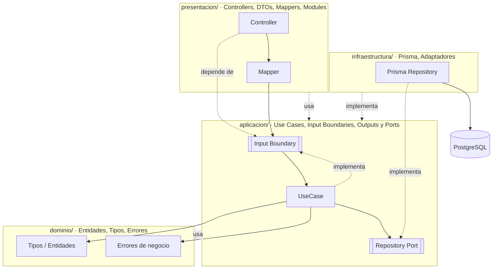
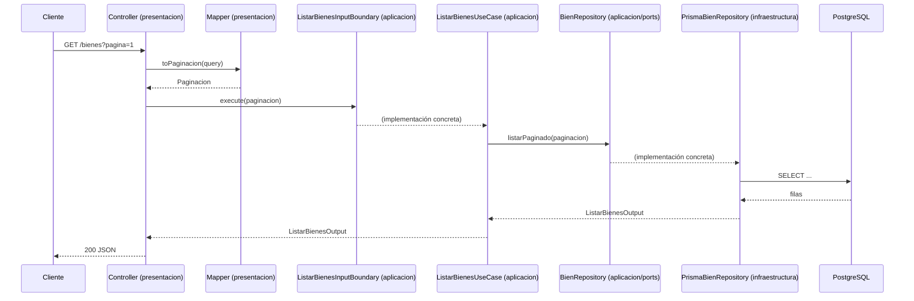

# Arquitectura

Backend del **Sistema de Gestión de Activos Fijos (SGAF) de la UMSS**: una API REST
desarrollada con **NestJS**, **Prisma 7** y **PostgreSQL** que administra los bienes
institucionales durante todo su ciclo de vida (alta, asignación, movimiento, baja),
con trazabilidad de responsable, ubicación y respaldo documental.

El proyecto sigue **Clean Architecture** con contratos explícitos de entrada y salida.
El dominio concentra las reglas de negocio; la aplicación orquesta los casos de uso y
declara los contratos que necesita; la infraestructura implementa esos contratos y la
presentación adapta HTTP.

## Terminología

- **Entidad (Entity)**: encapsula reglas e invariantes de negocio.
- **Caso de uso (Use Case / Interactor)**: orquesta una operación del sistema.
- **Input Boundary**: contrato de entrada que implementa un caso de uso y que consume
  el controller. Vive en la capa de aplicación.
- **Port**: contrato de salida que declara una capacidad que el caso de uso necesita
  (persistencia, reloj, referencias, etc.). Vive en `aplicacion/<modulo>/ports/`.
- **Output**: contrato de salida de un caso de uso. Vive en
  `aplicacion/<modulo>/output/<accion>.output.ts`.
- **Repository**: port de persistencia. Se declara en un archivo `*.repository.ts` y
  se implementa en infraestructura con un adaptador Prisma (`Prisma<Modulo>Repository`).
- **Adapter**: implementación concreta de un port. En este proyecto, los adaptadores
  principales son los repositorios Prisma y `RelojSistema`.

> En este proyecto no se usa la palabra *gateway*. Los contratos de salida se llaman
> **ports**; los de persistencia, **repositories**. Los contratos de entrada siguen
> llamándose **input boundaries**.

## ¿Por qué Clean Architecture?

- **Independencia de frameworks.** El dominio no conoce NestJS ni HTTP; los casos de
  uso se podrían ejecutar desde un CLI o un test sin levantar la API.
- **Independencia de la base de datos.** El dominio no conoce Prisma ni PostgreSQL.
  La aplicación declara los repositorios que necesita y la infraestructura los cumple.
- **Testabilidad.** Los casos de uso se prueban con dobles de sus ports, sin base de
  datos real.
- **Regla de dependencia.** Las dependencias siempre apuntan hacia el dominio. El
  dominio no importa nada de las capas externas.

## Las cuatro capas

| Capa | Responsabilidad | Depende de |
| --- | --- | --- |
| `dominio/` | Entidades, tipos, reglas y errores de negocio. | Nadie |
| `aplicacion/` | Casos de uso, input boundaries, outputs y ports de salida. | dominio |
| `presentacion/` | Controllers, DTOs, mappers y módulos Nest (DI). | aplicacion |
| `infraestructura/` | Adaptadores concretos: repositorios Prisma, reloj, filtros. | aplicacion y dominio |



La flecha `Prisma Repository -. implementa .-> Repository Port` es la **inversión de
dependencias**: la aplicación define el contrato y la infraestructura lo cumple, de
modo que el caso de uso nunca importa Prisma.

## Estructura de carpetas

La estructura va **primero por capa y luego por módulo**:

```text
src/
  dominio/                      # Reglas de negocio (sin NestJS, sin Prisma)
    bienes/
      entidades/bien.entity.ts
      errores/bien-no-encontrado.error.ts
      tipos/bien.ts
    procesos/
      entidades/proceso-workflow.entity.ts
      errores/
      tipos/proceso.ts
    tareas/tipos/
    comun/errores/              # DomainError, BusinessRuleError, NotFoundError

  aplicacion/                   # Casos de uso, input boundaries, outputs y ports
    bienes/
      tipos/bien.ts
      ports/bien.repository.ts
      ports/referencias-bien.repository.ts
      input/
        crear-bien.input.ts
        listar-bienes.input.ts
      input-boundary/
        crear-bien.input-boundary.ts
        listar-bienes.input-boundary.ts
      output/
        crear-bien.output.ts
        listar-bienes.output.ts
      use-case/
        crear-bien.use-case.ts
        listar-bienes.use-case.ts
    catalogos/
    personas/
    procesos/
    tareas/
    unidades/
    comun/ports/reloj.port.ts

  presentacion/                 # Adaptadores de entrada (HTTP)
    bienes/
      bienes.controller.ts
      bienes.module.ts
      dto/crear-bien.body.ts
      dto/listar-bienes.query.ts
      mappers/crear-bien.mapper.ts
    catalogos/
    personas/
    procesos/
    tareas/
    unidades/

  infraestructura/              # Adaptadores de salida (detalles técnicos)
    base-datos/
      prisma.module.ts
      prisma.service.ts
    bienes/
      prisma-bien.repository.ts
      prisma-referencias-bien.repository.ts
    catalogos/prisma-codificador.repository.ts
    personas/prisma-persona.repository.ts
    personas/prisma-usuario.repository.ts
    procesos/prisma-proceso.repository.ts
    tareas/prisma-tarea.repository.ts
    unidades/prisma-unidad.repository.ts
    comun/reloj-sistema.ts
    comun/http-exception.filter.ts

  app.module.ts                 # Módulo raíz: importa los módulos de presentación
  main.ts                       # Bootstrap de NestJS (pipes y filtros globales)
```

> Nota: `src/generated/prisma/` es código generado por Prisma (no se edita a mano).

## Cómo se construye un módulo

Cada módulo de negocio (`bienes`, `catalogos`, `personas`, `unidades`, …) se reparte
por las cuatro capas. Usamos **`bienes`** como ejemplo; todos los módulos siguen el
mismo patrón.

### 1. Dominio — entidad (reglas de negocio)

Las reglas del negocio viven en la entidad y no dependen de nada externo.

```ts
// src/dominio/bienes/entidades/bien.entity.ts
export class Bien {
  static crear(datos: DatosCreacionBien): Bien {
    // valida invariantes y lanza errores de dominio si se incumplen
  }

  static calcularPatrimonial(origen: OrigenTipo, solicitado: boolean): boolean {
    return origen === OrigenTipo.Propio ? solicitado : false;
  }

  static calcularCodigo(numero: number, esComponente: boolean, clase: string): string {
    const prefijo = esComponente || clase === 'material' ? 'NIM' : 'NIA';
    return `${prefijo}-${String(numero).padStart(5, '0')}`;
  }
}
```

### 2. Aplicación — port de repositorio

El port es una **clase abstracta** que actúa como token de inyección y define lo que
el caso de uso necesita. No conoce Prisma ni ningún detalle de infraestructura. Sus
salidas son contratos de aplicación declarados en los archivos `.output.ts` de cada
caso de uso.

```ts
// src/aplicacion/bienes/ports/bien.repository.ts
import type { NuevoBien } from '../tipos/bien';
import type { Paginacion } from '../../comun/paginacion/paginacion';
import type { CrearBienOutput } from '../output/crear-bien.output';
import type { ListarBienesOutput } from '../output/listar-bienes.output';
import type { ObtenerDetalleBienOutput } from '../output/obtener-detalle-bien.output';

export abstract class BienRepository {
  abstract listarPaginado(paginacion: Paginacion): Promise<ListarBienesOutput>;
  abstract obtenerDetalle(id: string): Promise<ObtenerDetalleBienOutput | null>;
  abstract crearConComponentes(
    padre: NuevoBien,
    componentes: NuevoBien[],
  ): Promise<CrearBienOutput>;
}
```

Reglas:

- Vive en `aplicacion/<modulo>/ports/`.
- El archivo termina en `.repository.ts` para ports de persistencia.
- La clase se llama `<Modulo>Repository` o `<Concepto>Repository`.
- Usa tipos de aplicación (`aplicacion/<modulo>/tipos/`) para entradas de persistencia y `*.output.ts` para salidas.
- Separa las referencias externas en su propio port (`ReferenciasBienRepository`).

### 3. Aplicación — input boundary + caso de uso

El **input boundary** es la frontera de entrada del caso de uso. El caso de uso lo
implementa y contiene la lógica de orquestación. No conoce NestJS, HTTP ni Prisma.

Cada caso de uso declara sus salidas en un archivo `.output.ts`. Ese archivo es el
contrato de salida de la aplicación: define el tipo del método principal y de los
métodos internos que devuelven datos. El dominio ya no contiene modelos de lectura.

```ts
// src/aplicacion/bienes/output/listar-bienes.output.ts
import type { PaginaOutput } from '../../comun/paginacion/paginacion.output';

export interface BienResumenOutput {
  id: string;
  codigo: string;
  descripcion: string;
  codificador: string;
  unidad: string;
  responsable: string;
  estado: string;
  atributos: Record<string, string>;
}

export type ListarBienesOutput = PaginaOutput<BienResumenOutput>;
```

```ts
// src/aplicacion/bienes/input-boundary/listar-bienes.input-boundary.ts
import type { Paginacion } from '../../comun/paginacion/paginacion';
import type { ListarBienesOutput } from '../output/listar-bienes.output';

export abstract class ListarBienesInputBoundary {
  abstract execute(paginacion: Paginacion): Promise<ListarBienesOutput>;
}
```

```ts
// src/aplicacion/bienes/use-case/listar-bienes.use-case.ts
import type { Paginacion } from '../../comun/paginacion/paginacion';
import type { BienRepository } from '../ports/bien.repository';
import type { ListarBienesInputBoundary } from '../input-boundary/listar-bienes.input-boundary';
import type { ListarBienesOutput } from '../output/listar-bienes.output';

export class ListarBienesUseCase implements ListarBienesInputBoundary {
  constructor(private readonly bienes: BienRepository) {}

  execute(paginacion: Paginacion): Promise<ListarBienesOutput> {
    return this.bienes.listarPaginado(paginacion);
  }
}
```

Cuando un caso de uso necesita validar reglas de negocio, delega en la entidad o lanza
errores del dominio (por ejemplo `BienNoEncontradoError`), que presentación traduce a
respuestas HTTP.

### 4. Infraestructura — repositorio Prisma

Implementa el port de aplicación. Es el **único lugar** que conoce Prisma. Puede tener
nombres y detalles propios de la base de datos.

```ts
// src/infraestructura/bienes/prisma-bien.repository.ts
import {
  calcularOffset,
  crearPaginaOutput,
  type Paginacion,
} from '../../aplicacion/comun/paginacion/paginacion';
import type { BienRepository } from '../../aplicacion/bienes/ports/bien.repository';
import type { ListarBienesOutput } from '../../aplicacion/bienes/output/listar-bienes.output';

@Injectable()
export class PrismaBienRepository implements BienRepository {
  constructor(private readonly prisma: PrismaService) {}

  async listarPaginado(paginacion: Paginacion): Promise<ListarBienesOutput> {
    const skip = calcularOffset(paginacion);
    const [total, filas] = await Promise.all([
      // count y findMany con skip/take...
    ]);
    return crearPaginaOutput(filas, total, paginacion);
  }
}
```

Reglas:

- Vive en `infraestructura/<modulo>/`.
- El archivo termina en `.repository.ts`.
- La clase se llama `Prisma<Modulo>Repository`.
- Lleva `@Injectable()` y recibe `PrismaService`.
- Traduce modelos Prisma a tipos de aplicación (`aplicacion/<modulo>/tipos/` o `*.output.ts`).
- Usa `$transaction` para escrituras compuestas.

### 5. Presentación — DTO, mapper y controller

- **DTO**: valida y tipa la entrada HTTP con `class-validator`/`class-transformer`.
- **Mapper**: traduce entre el mundo HTTP y los tipos de la aplicación.
- **Controller**: depende del **input boundary** (no de la clase del caso de uso).

```ts
// src/presentacion/bienes/dto/listar-bienes.query.ts
export class ListarBienesQuery {
  @IsOptional() @Type(() => Number) @IsInt() @Min(1)
  pagina?: number;

  @IsOptional() @Type(() => Number) @IsInt() @Min(1) @Max(1000)
  por_pagina?: number;
}
```

```ts
// src/presentacion/bienes/bienes.controller.ts
@Controller('bienes')
export class BienesController {
  constructor(
    @Inject(ListarBienesInputBoundary)
    private readonly listarBienes: ListarBienesInputBoundary,
    @Inject(ObtenerDetalleBienInputBoundary)
    private readonly obtenerDetalleBien: ObtenerDetalleBienInputBoundary,
  ) {}

  @Get()
  getBienes(@Query() query: ListarBienesQuery) {
    return this.listarBienes.execute(ListarBienesMapper.toPaginacion(query));
  }

  @Get(':id')
  getDetalle(@Param('id', ParseUUIDPipe) id: string) {
    return this.obtenerDetalleBien.execute(id);
  }
}
```

### 6. Presentación — módulo Nest (ensamble de dependencias)

El módulo no contiene lógica: sólo **cablea** ports con adaptadores y expone los casos
de uso a través de sus **input boundaries**.

```ts
// src/presentacion/bienes/bienes.module.ts
import { BienRepository } from '../../aplicacion/bienes/ports/bien.repository';
import { ListarBienesInputBoundary } from '../../aplicacion/bienes/input-boundary/listar-bienes.input-boundary';
import { ListarBienesUseCase } from '../../aplicacion/bienes/use-case/listar-bienes.use-case';
import { PrismaBienRepository } from '../../infraestructura/bienes/prisma-bien.repository';

@Module({
  controllers: [BienesController],
  providers: [
    { provide: BienRepository, useClass: PrismaBienRepository },
    {
      provide: ListarBienesInputBoundary,
      useFactory: (bienes: BienRepository) => new ListarBienesUseCase(bienes),
      inject: [BienRepository],
    },
  ],
})
export class BienesModule {}
```

Finalmente, el módulo raíz lo registra:

```ts
// src/app.module.ts
@Module({ imports: [PrismaModule, BienesModule, CatalogosModule, /* ... */] })
export class AppModule {}
```

## Flujo de una petición

Ejemplo de `GET /bienes`:



El `Controller` sólo depende del **input boundary**; el `UseCase` sólo conoce el
**port**. El `PrismaBienRepository` se inyecta por debajo sin que las capas internas lo
sepan.

## Reglas y convenciones del proyecto

- **El dominio no depende de NestJS ni de Prisma.** Sin decoradores `@Injectable`, sin
  repositorios y sin detalles técnicos.
- **La aplicación no depende de Prisma ni de NestJS.** Usa tipos del dominio, declara
  sus ports y expone casos de uso mediante **input boundaries**.
- **La infraestructura implementa los ports de aplicación.** Es la única capa con
  acceso a `PrismaService`.
- **La presentación orquesta, no decide.** Controllers finos que dependen de input
  boundaries, DTOs que validan, mappers que traducen y módulos que sólo arman la DI.
- **Terminología:** `Port` para contratos de salida, `Repository` para ports de
  persistencia e `Input Boundary` para contratos de entrada. No se usa *gateway*.
- **Nombres en español** para carpetas, tipos y conceptos del negocio.
- **Manejo de errores.** Los errores de negocio extienden `DomainError`. Un filtro
  global (`DomainExceptionFilter`) los traduce a HTTP: `code === 'NOT_FOUND'` → `404`,
  cualquier otro → `400`.
- **Configuración global de HTTP** en `main.ts`: `ValidationPipe` con `whitelist` y
  `forbidNonWhitelisted` (propiedades desconocidas → `400`), y el filtro de dominio.

### Notas de persistencia e interacción

- Los **atributos** del bien son dinámicos según su naturaleza (marca, serie, RAM,
  etc.). Se almacenan como `TEXT` serializado y la infraestructura se encarga de
  serializar/deserializar; hacia afuera se exponen como objeto `Record<string, string>`.
- La **paginación** usa `pagina`/`por_pagina` (máx. 1000) y responde con
  `total`, `total_paginas` y los campos `siguiente`/`anterior` (número de página o
  `null`). El tipo `Paginacion` y el cálculo de metadatos viven en
  `aplicacion/comun/paginacion/`.
- El **filtrado** (estado, codificador, atributos) se resuelve en el **frontend**
  sobre los datos paginados, para soportar caché y modo offline (PWA).

## Módulos como ejemplo

Todos los módulos siguen el patrón anterior. Algunos casos:

| Módulo | Rol | Ejemplos de endpoints |
| --- | --- | --- |
| **Bienes** | Registro, listado y detalle de activos/materiales. | `GET /bienes`, `GET /bienes/:id`, `POST /bienes` |
| **Catálogos** | Codificadores (clasificación contable de bienes). | `GET /codificadores`, `GET /codificadores/detalle` |
| **Unidades** | Unidades organizacionales (dueñas del bien). | `GET /unidades` |
| **Personas** | Personas y usuarios (responsables y roles). | `GET /personas`, `GET /usuarios` |

## Checklist para agregar un módulo

1. `dominio/<modulo>/tipos/` — solo tipos y enums usados por la lógica del dominio.
2. `dominio/<modulo>/entidades/` — entidades con las reglas de negocio.
3. `dominio/<modulo>/errores/` — errores de negocio propios, si hacen falta.
4. `aplicacion/<modulo>/tipos/` — tipos de entrada y persistencia que no usa el dominio.
5. `aplicacion/<modulo>/ports/` — define los ports (clases abstractas) y los
   `*.repository.ts` de persistencia.
6. `aplicacion/<modulo>/input/`, `input-boundary/`, `output/` y `use-case/` — separa
   los archivos de cada operación por tipo.
7. `aplicacion/<modulo>/output/<accion>.output.ts` — define las salidas del método
   principal y de los métodos internos.
8. `infraestructura/<modulo>/` — implementación Prisma de cada repository
   (`prisma-<modulo>.repository.ts`).
9. `presentacion/<modulo>/` — DTOs, mappers, controller y `.module.ts`.
10. Registra el módulo en `app.module.ts`.
11. Verifica con `bun run build` y `bun run lint`.
12. Confirma que `dominio/` no importa `aplicacion/` ni `infraestructura`.

## Notas de infraestructura

- **Prisma 7** con el driver adapter `@prisma/adapter-pg`; el cliente se genera en
  `src/generated/prisma`.
- `PrismaService` (`infraestructura/base-datos/`) abre y cierra la conexión en el
  ciclo de vida del módulo.
- Esquema en `prisma/schema.prisma`; migraciones en `prisma/migrations/`; datos demo
  reproducibles con `bun run db:seed`.
