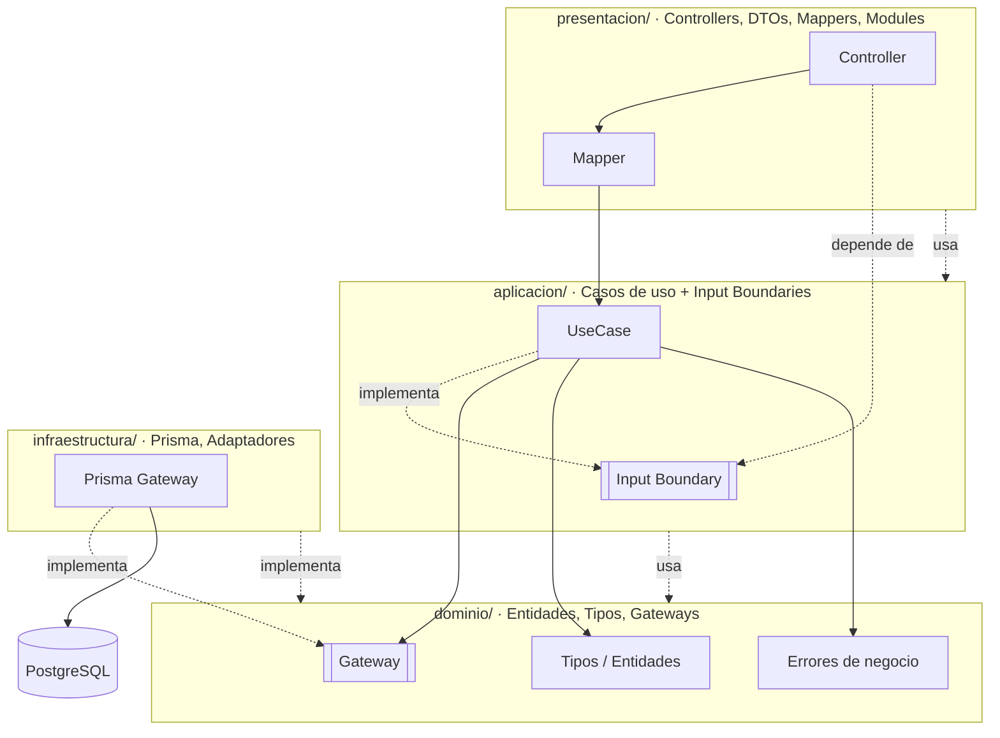
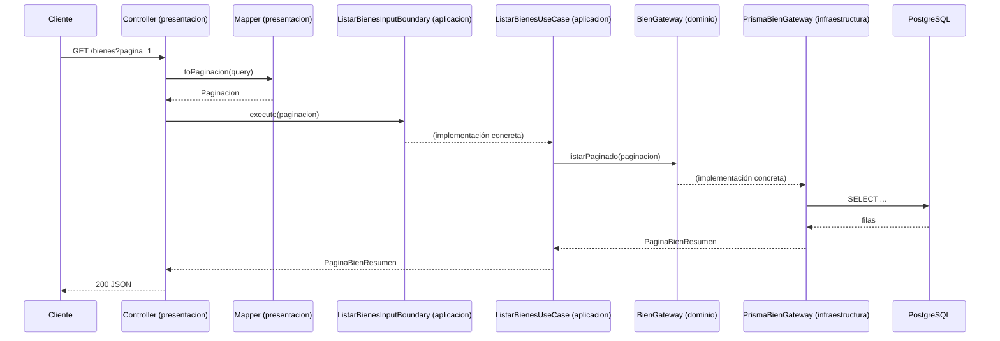

# Arquitectura

Backend del **Sistema de Gestión de Activos Fijos (SGAF) de la UMSS**: una API REST
desarrollada con **NestJS**, **Prisma 7** y **PostgreSQL** que administra los bienes
institucionales durante todo su ciclo de vida (alta, asignación, movimiento, baja),
con trazabilidad de responsable, ubicación y respaldo documental.

El proyecto sigue **Clean Architecture** (arquitectura limpia): el código se organiza
en capas concéntricas donde las reglas de negocio y los contratos viven en el centro,
y los detalles tecnológicos (NestJS, Prisma, HTTP) quedan en la periferia.

## Terminología

Se usa la terminología propia de Clean Architecture:

- **Entidad (Entity)**: encapsula reglas de negocio del dominio.
- **Caso de uso (Use Case / Interactor)**: orquesta una operación del sistema.
- **Frontera de entrada (Input Boundary)**: interfaz que expone un caso de uso y por la
  que lo invoca el mundo exterior (el controller depende de ella, no de la clase concreta).
- **Gateway (Entity Gateway)**: interfaz con la que el caso de uso accede a la persistencia;
  la infraestructura la implementa.

> Nota: se evita a propósito la terminología de *puertos* y *adaptadores*, propia de la
> arquitectura hexagonal. Aquí las fronteras se llaman **boundaries** y **gateways**.

## ¿Por qué Clean Architecture?

- **Independencia de frameworks.** El núcleo del negocio no conoce NestJS ni HTTP;
  los casos de uso se podrían ejecutar desde un CLI o un test sin levantar la API.
- **Independencia de la base de datos.** El dominio no conoce Prisma ni PostgreSQL;
  solo define los **gateways** que la infraestructura implementa.
- **Testabilidad.** Los casos de uso y las entidades se prueban sin base de datos real.
- **Regla de dependencia.** Las dependencias siempre apuntan **hacia el dominio**.
  Nunca al revés: el dominio no importa nada de las capas externas.

## Las cuatro capas

| Capa | Responsabilidad | Depende de |
| --- | --- | --- |
| `dominio/` | Entidades, tipos, reglas y **gateways** (contratos). | Nadie |
| `aplicacion/` | **Casos de uso** e **input boundaries**; orquestan el dominio. | dominio |
| `presentacion/` | Controllers, DTOs, mappers y módulos Nest (DI). | aplicacion |
| `infraestructura/` | Implementaciones concretas: Prisma y adaptadores. | dominio |



La flecha punteada `Prisma Gateway -. implementa .-> Gateway` es la **inversión de
dependencias**: el dominio define el contrato y la infraestructura lo cumple, de modo
que el caso de uso nunca importa Prisma.

## Estructura de carpetas

La estructura va **primero por capa y luego por módulo**:

```text
src/
  dominio/                      # Reglas y contratos (sin NestJS, sin Prisma)
    bienes/
      entidades/bien.entity.ts  # Entidad con reglas de negocio
      gateways/bien.gateway.ts   # Contratos de persistencia
      gateways/referencias-bien.gateway.ts
      errores/bien-no-encontrado.error.ts
      tipos/bien.ts             # Tipos y enums del módulo
    catalogos/
      gateways/codificador.gateway.ts
      tipos/codificador.ts
    personas/
      gateways/persona.gateway.ts
      gateways/usuario.gateway.ts
    unidades/
      gateways/unidad.gateway.ts
    comun/errores/              # Errores base reutilizables (DomainError, etc.)

  aplicacion/                   # Casos de uso + input boundaries
    bienes/
      listar-bienes/listar-bienes.use-case.ts
      listar-bienes/listar-bienes.input-boundary.ts
      crear-bien/crear-bien.use-case.ts
      crear-bien/crear-bien.input-boundary.ts
      crear-bien/crear-bien.input.ts
      obtener-detalle-bien/obtener-detalle-bien.use-case.ts
      obtener-detalle-bien/obtener-detalle-bien.input-boundary.ts
    catalogos/
    personas/
    unidades/

  presentacion/                 # Adaptadores de entrada (HTTP)
    bienes/
      bienes.controller.ts
      bienes.module.ts
      dto/crear-bien.body.ts
      dto/listar-bienes.query.ts
      mappers/crear-bien.mapper.ts
    catalogos/
    personas/
    unidades/

  infraestructura/              # Adaptadores de salida (detalles técnicos)
    base-datos/
      prisma.module.ts
      prisma.service.ts
    bienes/
      prisma-bien.gateway.ts
      prisma-referencias-bien.gateway.ts
    catalogos/prisma-codificador.gateway.ts
    personas/prisma-persona.gateway.ts
    personas/prisma-usuario.gateway.ts
    unidades/prisma-unidad.gateway.ts
    comun/http-exception.filter.ts

  app.module.ts                 # Módulo raíz: importa los módulos de presentación
  main.ts                       # Bootstrap de NestJS (pipes y filtros globales)
```

> Nota: `src/generated/prisma/` es código generado por Prisma (no se edita a mano).

## Cómo se construye un módulo

Cada módulo de negocio (`bienes`, `catalogos`, `personas`, `unidades`, …) se reparte
por las cuatro capas. Usamos **`bienes`** como ejemplo; todos los módulos siguen el
mismo patrón.

### 1. Dominio — entidad (reglas de negocio)

Las reglas del negocio viven en la entidad y no dependen de nada externo.

```ts
// src/dominio/bienes/entidades/bien.entity.ts
export class Bien {
  static crear(datos: DatosCreacionBien): Bien {
    // valida invariantes y lanza errores de dominio si se incumplen
  }

  static calcularPatrimonial(origen: OrigenTipo, solicitado: boolean): boolean {
    return origen === OrigenTipo.Propio ? solicitado : false;
  }

  static calcularCodigo(numero: number, esComponente: boolean, clase: string): string {
    const prefijo = esComponente || clase === 'material' ? 'NIM' : 'NIA';
    return `${prefijo}-${String(numero).padStart(5, '0')}`;
  }
}
```

### 2. Dominio — gateway (contrato de persistencia)

El gateway es una **clase abstracta** que actúa como token de inyección y define los
métodos que la infraestructura debe implementar. El caso de uso depende de esta
abstracción, no de Prisma.

```ts
// src/dominio/bienes/gateways/bien.gateway.ts
export abstract class BienGateway {
  abstract listarPaginado(paginacion: Paginacion): Promise<PaginaBienResumen>;
  abstract obtenerDetalle(id: string): Promise<BienDetalle | null>;
  abstract crearConComponentes(
    padre: NuevoBien,
    componentes: NuevoBien[],
  ): Promise<BienCreado>;
}
```

### 3. Aplicación — input boundary + caso de uso

El **input boundary** es la frontera de entrada del caso de uso. El caso de uso lo
implementa y contiene la lógica de orquestación. No conoce NestJS, HTTP ni Prisma.

```ts
// src/aplicacion/bienes/listar-bienes/listar-bienes.input-boundary.ts
export abstract class ListarBienesInputBoundary {
  abstract execute(paginacion: Paginacion): Promise<PaginaBienResumen>;
}
```

```ts
// src/aplicacion/bienes/listar-bienes/listar-bienes.use-case.ts
export class ListarBienesUseCase implements ListarBienesInputBoundary {
  constructor(private readonly bienes: BienGateway) {}

  execute(paginacion: Paginacion) {
    return this.bienes.listarPaginado(paginacion);
  }
}
```

Cuando un caso de uso necesita validar reglas de negocio, delega en la entidad o lanza
errores del dominio (por ejemplo `BienNoEncontradoError`), que presentación traduce a
respuestas HTTP.

### 4. Presentación — DTO, mapper y controller

- **DTO**: valida y tipa la entrada HTTP con `class-validator`/`class-transformer`.
- **Mapper**: traduce entre el mundo HTTP y los tipos de la aplicación.
- **Controller**: depende del **input boundary** (no de la clase del caso de uso).

```ts
// src/presentacion/bienes/dto/listar-bienes.query.ts
export class ListarBienesQuery {
  @IsOptional() @Type(() => Number) @IsInt() @Min(1)
  pagina?: number;

  @IsOptional() @Type(() => Number) @IsInt() @Min(1) @Max(1000)
  por_pagina?: number;
}
```

```ts
// src/presentacion/bienes/bienes.controller.ts
@Controller('bienes')
export class BienesController {
  constructor(
    @Inject(ListarBienesInputBoundary)
    private readonly listarBienes: ListarBienesInputBoundary,
    @Inject(ObtenerDetalleBienInputBoundary)
    private readonly obtenerDetalleBien: ObtenerDetalleBienInputBoundary,
  ) {}

  @Get()
  getBienes(@Query() query: ListarBienesQuery) {
    return this.listarBienes.execute(ListarBienesMapper.toPaginacion(query));
  }

  @Get(':id')
  getDetalle(@Param('id', ParseUUIDPipe) id: string) {
    return this.obtenerDetalleBien.execute(id);
  }
}
```

### 5. Infraestructura — gateway Prisma

Implementa el gateway del dominio. Es el **único lugar** que conoce Prisma. Puede tener
nombres y detalles propios de la base de datos.

```ts
// src/infraestructura/bienes/prisma-bien.gateway.ts
@Injectable()
export class PrismaBienGateway implements BienGateway {
  constructor(private readonly prisma: PrismaService) {}

  async listarPaginado(paginacion: Paginacion): Promise<PaginaBienResumen> {
    // consultas a Prisma...
  }
}
```

### 6. Presentación — módulo Nest (ensamble de dependencias)

El módulo no contiene lógica: sólo **cablea** gateways con implementaciones y expone
los casos de uso a través de sus **input boundaries**.

```ts
// src/presentacion/bienes/bienes.module.ts
@Module({
  controllers: [BienesController],
  providers: [
    { provide: BienGateway, useClass: PrismaBienGateway },
    {
      provide: ListarBienesInputBoundary,
      useFactory: (bienes: BienGateway) => new ListarBienesUseCase(bienes),
      inject: [BienGateway],
    },
  ],
})
export class BienesModule {}
```

Finalmente, el módulo raíz lo registra:

```ts
// src/app.module.ts
@Module({ imports: [PrismaModule, BienesModule, CatalogosModule, /* ... */] })
export class AppModule {}
```

## Flujo de una petición

Ejemplo de `GET /bienes`:



El `Controller` sólo depende del **input boundary**; el `UseCase` sólo conoce el
**gateway**. El `PrismaBienGateway` se inyecta por debajo sin que las capas internas lo sepan.

## Reglas y convenciones del proyecto

- **El dominio no depende de NestJS.** Sin decoradores `@Injectable`, sin Prisma.
- **La aplicación no depende de Prisma ni de NestJS.** Sólo usa gateways y tipos del
  dominio; expone casos de uso mediante **input boundaries**.
- **La infraestructura implementa los gateways del dominio.** Es la única capa con
  acceso a `PrismaService`.
- **La presentación orquesta, no decide.** Controllers finos que dependen de input
  boundaries, DTOs que validan, mappers que traducen y módulos que sólo arman la DI.
- **Terminología Clean.** Se usa `Gateway` (Entity Gateway) e `Input Boundary`; no se
  usa la palabra *puerto* (hexagonal).
- **Nombres en español** para carpetas, tipos y conceptos del negocio.
- **Manejo de errores.** Los errores de negocio extienden `DomainError`. Un filtro
  global (`DomainExceptionFilter`) los traduce a HTTP: `code === 'NOT_FOUND'` → `404`,
  cualquier otro → `400`.
- **Configuración global de HTTP** en `main.ts`: `ValidationPipe` con `whitelist` y
  `forbidNonWhitelisted` (propiedades desconocidas → `400`), y el filtro de dominio.

### Notas de persistencia e interacción

- Los **atributos** del bien son dinámicos según su naturaleza (marca, serie, RAM,
  etc.). Se almacenan como `TEXT` serializado y la infraestructura se encarga de
  serializar/deserializar; hacia afuera se exponen como objeto `Record<string, string>`.
- La **paginación** usa `pagina`/`por_pagina` (máx. 1000) y responde con
  `total`, `total_paginas` y los campos `siguiente`/`anterior` (número de página o
  `null`).
- El **filtrado** (estado, codificador, atributos) se resuelve en el **frontend**
  sobre los datos paginados, para soportar caché y modo offline (PWA).

## Módulos como ejemplo

Todos los módulos siguen el patrón anterior. Algunos casos:

| Módulo | Rol | Ejemplos de endpoints |
| --- | --- | --- |
| **Bienes** | Registro, listado y detalle de activos/materiales. | `GET /bienes`, `GET /bienes/:id`, `POST /bienes` |
| **Catálogos** | Codificadores (clasificación contable de bienes). | `GET /codificadores`, `GET /codificadores/detalle` |
| **Unidades** | Unidades organizacionales (dueñas del bien). | `GET /unidades` |
| **Personas** | Personas y usuarios (responsables y roles). | `GET /personas`, `GET /usuarios` |

## Checklist para agregar un módulo

1. `dominio/<modulo>/tipos/` — define tipos y enums del negocio.
2. `dominio/<modulo>/entidades/` — entidades con las reglas de negocio.
3. `dominio/<modulo>/gateways/` — define los gateways (clases abstractas).
4. `dominio/<modulo>/errores/` — errores de negocio propios, si hacen falta.
5. `aplicacion/<modulo>/<caso-de-uso>/` — input boundary + caso de uso por operación.
6. `infraestructura/<modulo>/` — implementación Prisma de cada gateway.
7. `presentacion/<modulo>/` — DTOs, mappers, controller y `.module.ts`.
8. Registra el módulo en `app.module.ts`.
9. Verifica con `bun run build`, `bun run lint` y `bun run test`.

## Notas de infraestructura

- **Prisma 7** con el driver adapter `@prisma/adapter-pg`; el cliente se genera en
  `src/generated/prisma`.
- `PrismaService` (`infraestructura/base-datos/`) abre y cierra la conexión en el
  ciclo de vida del módulo.
- Esquema en `prisma/schema.prisma`; migraciones en `prisma/migrations/`; datos demo
  reproducibles con `bun run db:seed`.
